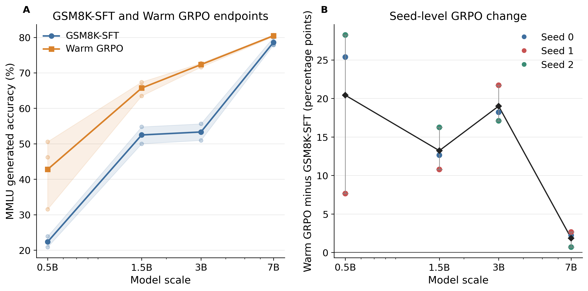
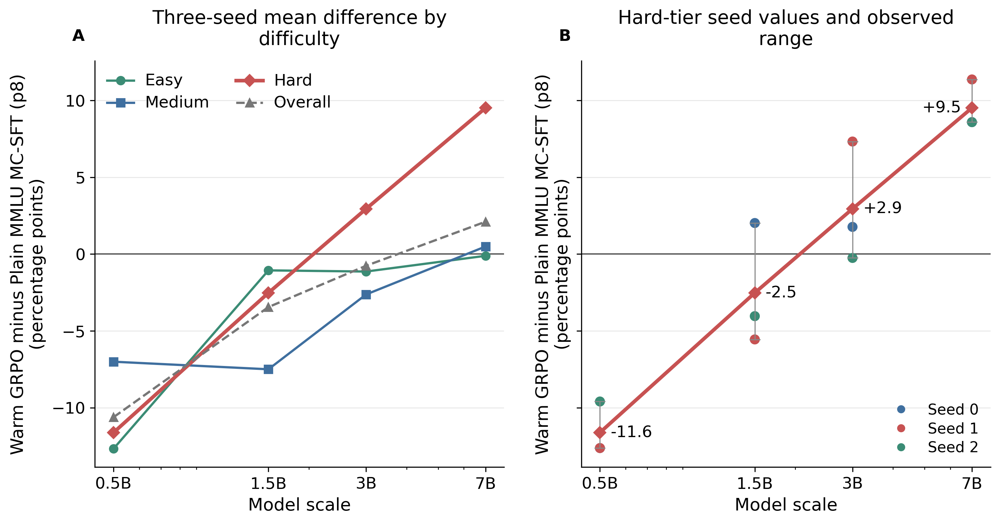
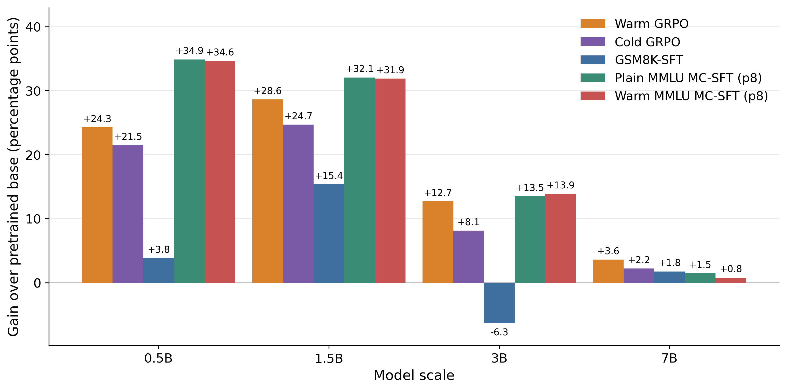
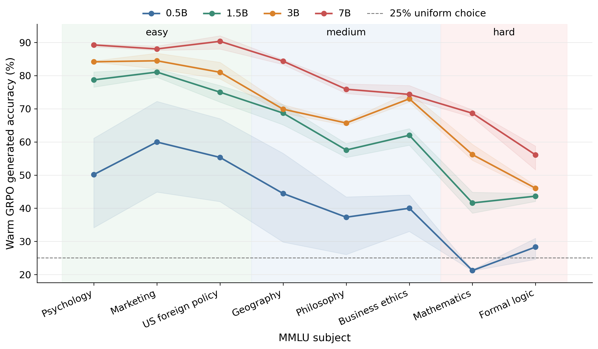
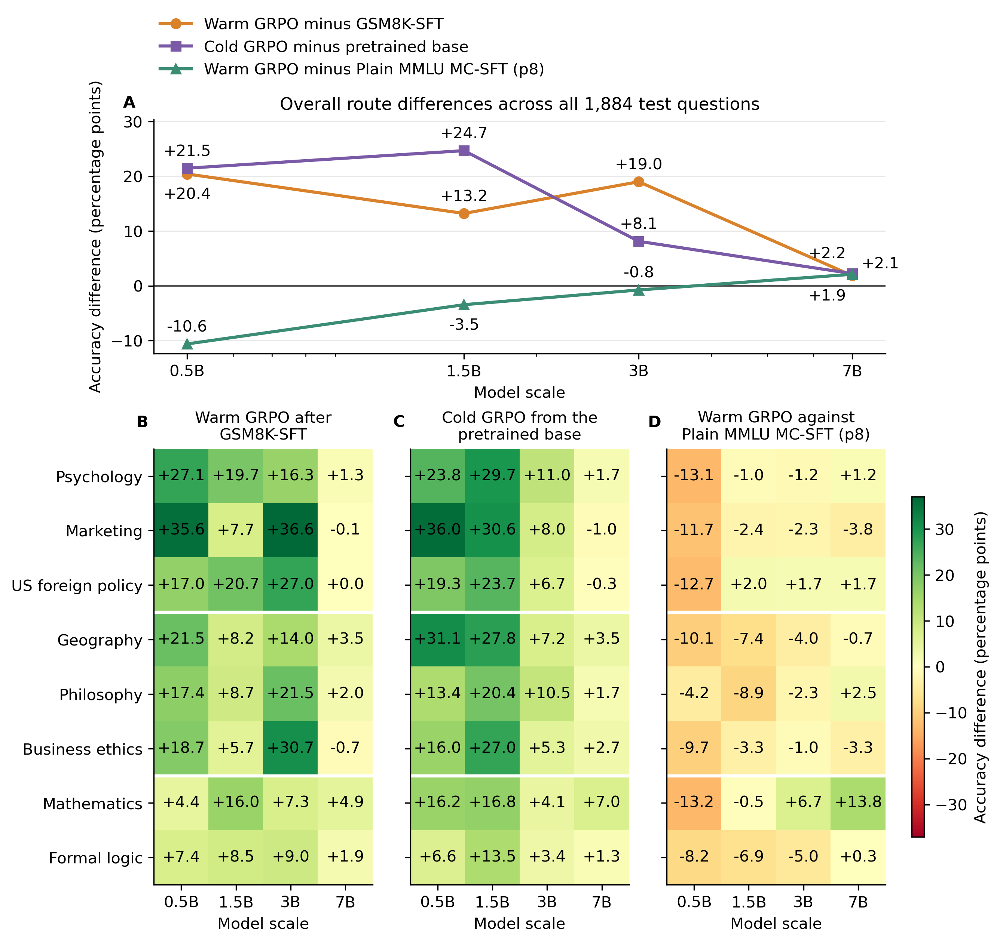
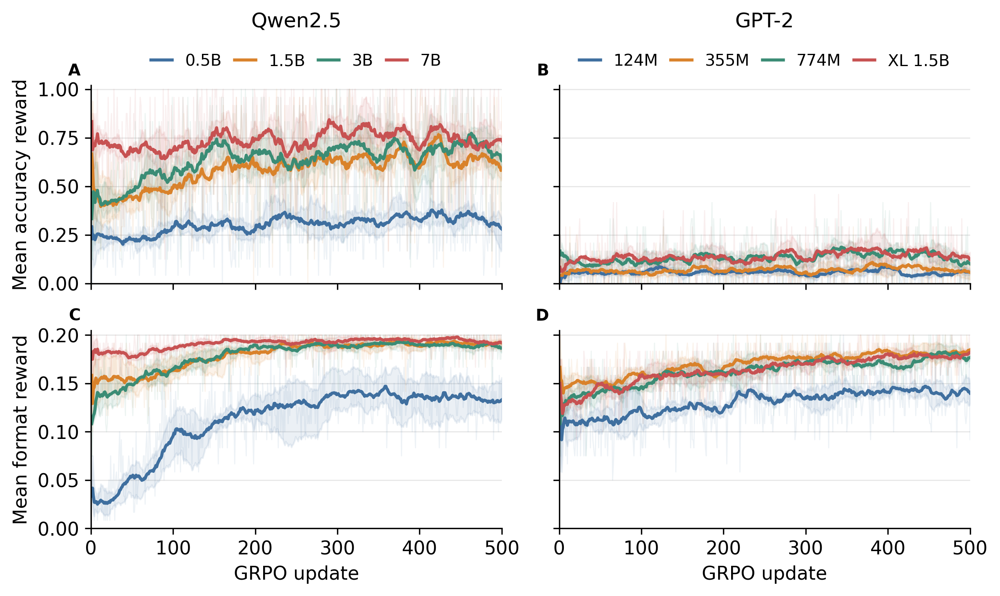
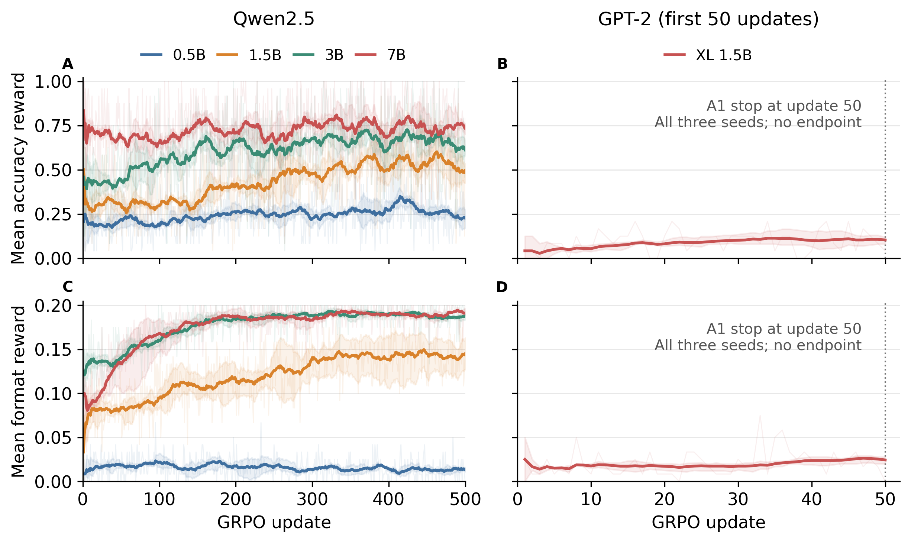
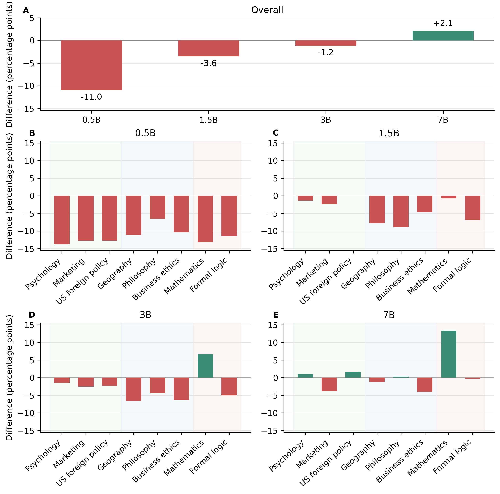
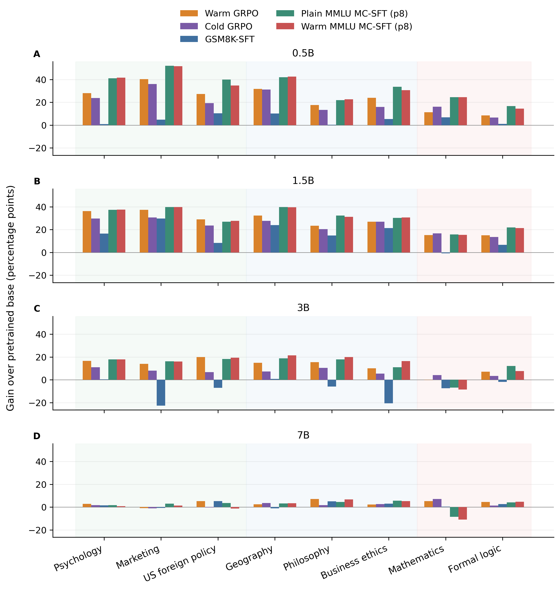

# Reinforcement Learning or Supervised Fine-Tuning for Large Language Models? GRPO Across Scale and Difficulty Tiers

**Oleh Hastov and Eduardo Alonso · City St George's, University of London**

When does reinforcement learning improve a language model beyond supervised training, and how does that depend on model size and question difficulty? We compare **supervised fine-tuning (SFT)**, which learns from supplied answers, with **Group Relative Policy Optimization (GRPO)**, which learns from rewards assigned to groups of generated responses.

[Check the main result on CPU](#checks-without-a-gpu) · [Repository guide](#repository-guide) · [Reproducibility](#reproducibility) · [Download checkpoints](#download-checkpoints) · [Saved results](001_Code/results/) · [Experiment notebooks](001_Code/notebooks/)

## What was developed

- **GPT-2 implementation from scratch and validation.** Extended a PyTorch transformer implementation into a causal language model, adding tied embeddings, cached generation, pretrained-weight conversion, save/reload support and numerical checks. Models load OpenAI's pretrained weights, so no model is trained from random initialisation. The [implementation notes and source acknowledgements](002_GPT2_From_Scratch/README.md) credit the tutorial sources. Key code: [model](002_GPT2_From_Scratch/gpt2_scratch/model.py), [attention](002_GPT2_From_Scratch/gpt2_scratch/attention.py), [pretrained-weight conversion](002_GPT2_From_Scratch/gpt2_scratch/weights.py), [numerical tests](002_GPT2_From_Scratch/tests/).
- **Shared experimental pipeline.** Built configuration-driven data preparation, rewards, prompts, checkpoint handling, training controls and evaluation for Qwen2.5 and GPT-2. The pipeline integrates Transformers and PEFT. TRL's `GRPOTrainer` supplies the GRPO optimisation loop. Key code: [configuration](001_Code/config.py), [data preparation](001_Code/data/), [answer extraction](001_Code/data/mmlu.py), [reward functions](001_Code/train/reward.py), [checkpoint handling](001_Code/checkpoint.py), [SFT](001_Code/train/sft.py), [GRPO integration](001_Code/train/grpo.py), [evaluation](001_Code/eval/harness.py), [run entry point](001_Code/scripts/run.py).
- **Controlled experimentation.** Designed comparisons across model scales, subjects and seeds, including supervised controls, training-start comparisons, longer training, stopping rules and matched parameterisation studies. Key code: [experiment configurations](001_Code/configs/), [stopping rules](001_Code/obs.py), [matched parameterisation worker](001_Code/scripts/s35_matched_grpo.py) and other [experiment workers](001_Code/scripts/).
- **Analysis tools.** Developed analysis, paired statistical comparisons, training diagnostics and plots to examine accuracy, response format, seed variation and answer-letter probabilities. Key code: [paired statistics](001_Code/analysis/stats.py), [accuracy metrics](001_Code/eval/metrics.py), [training diagnostics](001_Code/train/parser_diagnostics.py) and the [paper figure notebook](001_Code/notebooks/054_paper_figures.ipynb).

## Study design

The main study uses **Qwen2.5 at 0.5B, 1.5B, 3B and 7B**. A separate GPT-2 family covers 124M, 355M, 774M and 1.5B. It is not pooled with Qwen as one scaling series.

GSM8K, a collection of grade-school maths problems, supplies the supervised warm start. MMLU, a multi-choice knowledge benchmark, supplies eight subjects grouped into easy, medium and hard tiers, with **1,884 held-out questions**. Warm GRPO starts after GSM8K-SFT. Cold GRPO starts directly from the pretrained base. Plain MMLU MC-SFT provides direct answer-letter supervision on the same 245-item MMLU training pool used by GRPO.

[](001_Code/docs/diagrams/C18%20-%20Final.svg)

*Overview of the main routes only. Additional experiments are left out. Open the actual diagram for the full-size vector version and stopping notes.*

## Selected findings

### Gains over the supervised warm start

[](001_Code/analysis/figures/054/JF02_qwen_scale_response.png)

Warm GRPO's mean accuracy rises with model scale, but its gain over GSM8K-SFT doesn't increase monotonically: **+20.42, +13.22, +19.00 and +1.86 percentage points**, respectively. Dots represent three fixed seeds. Bands and whiskers span the lowest to highest seed result, describing observed spread only (no confidence intervals).

### Comparison with direct MMLU supervision

[](001_Code/analysis/figures/054/JF01_grpo_plain_mmlu_mc_sft.png)

Against Plain MMLU MC-SFT with eight passes over the training pool (`p8`), Warm GRPO is lower overall at 0.5B, 1.5B and 3B. At 7B it leads by **2.1 points overall and 9.5 points on the hard tier**, mainly through high-school mathematics. Positive values favour GRPO. These compare complete training recipes, and their **compute budgets differ**.

### Warm versus Cold GRPO

Warm GRPO starts from the GSM8K-SFT endpoint. Cold GRPO uses the pretrained base without the GSM8K-SFT stage. At 3B, the warm start gave a higher overall endpoint in all three seed-matched pairs: **+3.9, +4.6, +5.3 percentage points**. On the hard tier, Warm GRPO was **0.8 to 2.3 percentage points lower** in every pair. At 1.5B, all three pairs favour the warm start on overall accuracy. At 0.5B, the result is mixed, with lower accuracy for the stalled warm run at seed 1. At 7B, two pairs are inconclusive and one shows a material warm advantage.

### Generated answers versus the answer-letter probe

The answer-letter probe scores the four options at the answer position without generating a response. With rank-16 Low-Rank Adaptation (LoRA), GRPO changed generated accuracy across the 24 core Warm and Cold Qwen2.5 runs, while the probe changed much less. From GSM8K-SFT to Warm GRPO, three-seed mean probe accuracy changed by **+0.34, +0.21, +0.35, -0.16 percentage points** at 0.5B, 1.5B, 3B and 7B, respectively. This suggests that the models became better at expressing or selecting answers under this evaluation, but it doesn't prove that they gained no new knowledge. The probe is not a complete measure of knowledge, and its positive control check was inconclusive. For Warm GRPO, generated accuracy on the hard tier was well below the probe at 0.5B and **7 to 9 percentage points above it at 7B**, with both measures taken from the same checkpoints.

These findings hold for the selected subjects and tested recipes only. Broader language-model capabilities were outside the study. The plotted main comparisons use three seeds, but some additional studies use one.

## More results

### Five training routes across model scales

[](001_Code/analysis/figures/054/JF17_qwen_training_route_map_v40.png)

Mean gains over the pretrained base across three seeds for completed routes. Each bar combines every stage of its route, and the routes used different amounts of compute.

### Warm GRPO performance by subject

[](001_Code/analysis/figures/054/JF18_qwen_subject_scaling.png)

Absolute accuracy, with no baseline subtracted. Lines show three-seed means. Shading covers the observed spread across seeds and has no confidence-interval interpretation.

### Route differences across subjects

[](001_Code/analysis/figures/054/JF19_qwen_route_synthesis_v40.png)

Three-seed mean differences: Warm GRPO versus GSM8K-SFT, Cold GRPO versus pretrained base, and Warm GRPO versus Plain MMLU MC-SFT p8.

### Warm GRPO training curves

[](001_Code/analysis/figures/054/JF11_recorded_reward_trajectories.png)

Rewards on the training pool, measured separately from held-out test accuracy. Thick lines show three-seed means with trailing 25-update smoothing. Shading shows observed seed ranges, not confidence intervals.

### Cold GRPO training curves

[](001_Code/analysis/figures/054/JF12_cold_reward_trajectories.png)

As in the Warm GRPO plot, the curves show training-pool rewards. Test accuracy is measured separately. Thick lines are smoothed three-seed means. Shading shows seed ranges. GPT-2 XL stopped at update 50 without evaluated endpoints. Smaller GPT-2 scales were not run on this route.

### Comparison with the strongest tested supervised alternatives

[](001_Code/analysis/figures/054/JF16_qwen_best_tested_mc_sft.png)

Positive values favour Warm GRPO. The strongest tested MMLU MC-SFT alternative is selected separately overall and per subject using three-seed means. This descriptive comparison is not compute matched.

### Subject gains across five training routes

[](001_Code/analysis/figures/054/JF20_qwen_subject_recipe_gains_v40.png)

All bars show gains over the pretrained base, not the added effect of GRPO after SFT. These route comparisons are not compute matched.

## Repository guide

| Location | Contents |
| --- | --- |
| [Code](001_Code/) | Configurations, data preparation, SFT/GRPO training, evaluation and experiment workers |
| [Experiment notebooks](001_Code/notebooks/) | Colab runs and analyses, organised by experiment number |
| [Experiment chronology](CHRONOLOGY.md) | Dates, experiment groups and links to the saved research record |
| [Saved results](001_Code/results/) | Predictions, metrics, training logs and run manifests |
| [Paper figure notebook](001_Code/notebooks/054_paper_figures.ipynb) | Code for all 24 analytical figures in the paper and appendix |
| [Tests](001_Code/tests/) | Protocol, configuration, reward, evaluation and execution checks |
| [GPT-2 package](002_GPT2_From_Scratch/) | Model implementation, weight conversion, numerical tests and third-party notices |

## Getting started

We used Python 3.13.5 to run the local tests and all five checks on the saved results.

From the repository root, create an isolated Python environment and install the experiment dependencies and local GPT-2 package:

```bash
python3 -m venv .venv
source .venv/bin/activate
python -m pip install -r 001_Code/requirements.txt
python -m pip install -e "002_GPT2_From_Scratch"
cd 001_Code
```

Check configuration wiring without loading a model or launching training:

```bash
python scripts/run.py --config configs/smoke_local.yaml --stage wiring
```

With internet access, run this once to cache the pinned GPT-2 model, its Hugging Face tokenizer and the separate `tiktoken` encoding used by the parity tests. The pipeline tests also use `sshleifer/tiny-gpt2` and its tokenizer.

```bash
python - <<'PYTHON'
import tiktoken
from transformers import GPT2LMHeadModel, GPT2TokenizerFast

revision = '607a30d783dfa663caf39e06633721c8d4cfcd7e'
GPT2LMHeadModel.from_pretrained('gpt2', revision=revision)
GPT2TokenizerFast.from_pretrained('gpt2', revision=revision)
tiktoken.get_encoding('gpt2')

GPT2LMHeadModel.from_pretrained('sshleifer/tiny-gpt2')
GPT2TokenizerFast.from_pretrained('sshleifer/tiny-gpt2')
PYTHON
```

Then run the pipeline and GPT-2 tests from `001_Code`.

```bash
python -m pytest tests/ "../002_GPT2_From_Scratch/tests"
```

See the [GPT-2 package instructions](002_GPT2_From_Scratch/README.md) for details of the parity tests. The wiring check does not run training.

For a complete run example, see the [3B SFT-to-GRPO notebook](001_Code/notebooks/003_colab_3b_full.ipynb) alongside its [seed-0 results](001_Code/results/003_COLAB_FULL_B3_sft_grpo_seed0/). Full reruns require the recorded GPU environment, data and checkpoint access. Check run manifests for historical software versions. The Git commit IDs recorded in the original run manifests refer to the private development repository used for the experiments. The local requirements file is not a universal recreation of every Colab environment. Keep new outputs separate from completed run directories.

## Reproducibility

The five checks below read the saved prediction files and need only Python 3. Download checkpoints to evaluate a trained model again. Full training runs require a GPU and the settings described below.

### Checks without a GPU

Run these commands from the repository root. Each check compares the saved answer letter for each response with the correct letter. Differences and ranges are in percentage points.

| Result | Command | Expected result |
| --- | --- | --- |
| 7B hard tier, Warm GRPO against six MC-SFT variants (21 files) | `python3 001_Code/scripts/check_paper_results.py` | Warm GRPO leads by 9.4 to 11.0 points. |
| 7B subjects, Warm GRPO against the best MC-SFT variant for each subject (three-seed means) | `python3 001_Code/scripts/check_paper_results.py --subjects` | 68.64% vs 55.31% (Plain p16) in high-school mathematics and 56.08% vs 56.35% (Warm p8) in formal logic. |
| Overall accuracy below 7B, Plain MC-SFT at eight passes against Warm GRPO (18 files) | `python3 001_Code/scripts/check_paper_results.py --below-7b` | MC-SFT leads by 10.6, 3.5 and 0.8 points at 0.5B, 1.5B and 3B, respectively. |
| GRPO with and without prior GSM8K training, paired by seed (12 files) | `python3 001_Code/scripts/check_paper_results.py --warm-start` | Warm GRPO leads overall in all three pairs at both 1.5B and 3B. On the 3B hard tier it trails Cold GRPO by 2.27, 0.76 and 2.02 points for seeds 0, 1 and 2. |
| Final Warm GRPO overall accuracy, highest minus lowest of three seeds | `python3 001_Code/scripts/check_paper_results.py --seed-spread` | The ranges are 19.1, 3.9, 1.1 and 0.5 points at 0.5B, 1.5B, 3B and 7B, respectively. |

**Other saved results**

- **GPT-2 (Section 4.6).** The [summary by model size](001_Code/analysis/figures/048_1/048_1_gpt2_scale_summary.csv) reports generated accuracy, answer-letter probe accuracy and formatting before and after GRPO. The [results for each seed](001_Code/analysis/figures/048_1/048_1_gpt2_seed_values.csv) show how often an answer letter could be extracted and which comparisons passed the paper’s coverage checks.
- **Qwen2.5 answer-letter probe (Section 4.3).** The Qwen rows in the [results by model and seed](001_Code/analysis/figures/048_1/048_1_qwen_gpt2_seed_values.csv) give generated accuracy and probe accuracy after GSM8K-SFT and after Warm GRPO. To inspect individual answers, open the [7B seed 0 run](001_Code/results/013_COLAB_FULL_B7_sft_grpo_seed0/). The `sft_preds.jsonl` and `grpo_preds.jsonl` files contain the written responses. The corresponding `*_logprob_preds.jsonl` files record the letter selected by the probe for each question.

Run all cells in [notebook 054](001_Code/notebooks/054_paper_figures.ipynb) on CPU to regenerate all 24 analytical figures. The nine plots above are paper Figures [1](001_Code/analysis/figures/054/JF01_grpo_plain_mmlu_mc_sft.pdf), [3](001_Code/analysis/figures/054/JF02_qwen_scale_response.pdf), [5](001_Code/analysis/figures/054/JF18_qwen_subject_scaling.pdf), [7](001_Code/analysis/figures/054/JF19_qwen_route_synthesis_v40.pdf), [8](001_Code/analysis/figures/054/JF16_qwen_best_tested_mc_sft.pdf), [16](001_Code/analysis/figures/054/JF11_recorded_reward_trajectories.pdf) and [17](001_Code/analysis/figures/054/JF17_qwen_training_route_map_v40.pdf), and Appendix B Figures [B2](001_Code/analysis/figures/054/JF20_qwen_subject_recipe_gains_v40.pdf) and [B7](001_Code/analysis/figures/054/JF12_cold_reward_trajectories.pdf). The notebook reads saved predictions and training records and writes each figure as PNG and PDF to `001_Code/analysis/figures/054/`. The paper exports used Python 3.13.5, Matplotlib 3.10.0, NumPy 2.1.3 and pandas 2.2.3.

The plotting notebooks need these packages:

```bash
python -m pip install matplotlib pandas jupyter pyyaml
```

- **Workflow diagram.** Figure 2 was drawn separately. The original [SVG](001_Code/docs/diagrams/C18%20-%20Final.svg) is included in the repository.
- **Data splits.** From `001_Code`, `python scripts/build_data.py --limit 8` constructs capped GSM8K and MMLU splits in memory, downloading the datasets on first use. It removes MMLU training prompts found in the full test split and checks normalised prompt overlap between the constructed splits. This is a smoke check, not proof against every form of leakage. Omit `--limit` to check the full splits. The [saved MMLU split audit](001_Code/results/split_audit_17Jul2026.json) records 246 training questions before deduplication, 245 after it and 1,884 test questions, along with the near-duplicate checks and dataset revisions.
- **Tests.** The one-time GPT-2 setup and the test command are in [Getting started](#getting-started).

### Rerunning experiments on a GPU

Start with the main study examples below. These are historical run notebooks, not interchangeable launchers. Check their selected seeds, required checkpoints and output paths before running them.

| Purpose | Notebook entry points | Scope |
| --- | --- | --- |
| Main 3B SFT-to-GRPO pipeline | [003, seed 0](001_Code/notebooks/003_colab_3b_full.ipynb), [seed 1](001_Code/notebooks/003_colab_3b_seed1.ipynb), [seed 2](001_Code/notebooks/003_colab_3b_seed2.ipynb) | Clearest end-to-end starting point |
| Smaller Qwen scales | [006, 0.5B](001_Code/notebooks/006_colab_0p5b_frozen_a100.ipynb), [009, 1.5B](001_Code/notebooks/009_colab_1p5b_full.ipynb) | The saved 006 session also evaluates earlier supervised checkpoints. 009 has a [separate seed-2 notebook](001_Code/notebooks/009_colab_1p5b_seed2.ipynb) |
| 7B extension | [013 memory pilot](001_Code/notebooks/013_colab_7b_pilot_a.ipynb), [phase 1](001_Code/notebooks/013_colab_7b_phase1.ipynb), [phase 2](001_Code/notebooks/013_colab_7b_phase2.ipynb), [seed 2](001_Code/notebooks/013_colab_7b_seed2.ipynb) | Requires A100 80 GB. Later phases reuse earlier outputs |
| Cold versus Warm GRPO at 3B | [004, seed 0](001_Code/notebooks/004_colab_3b_base_grpo.ipynb), [seeds 1 and 2](001_Code/notebooks/004_colab_3b_base_grpo_seeds12.ipynb) | Cold route for comparison with 003 |
| Supervised comparison routes | [007, 0.5B and 3B](001_Code/notebooks/007_colab_mc_sft.ipynb), [014/015, 7B](001_Code/notebooks/014_015_colab_7b_mc_sft.ipynb) | Training and evaluation coverage differs by session. Follow the recorded checkpoint dependencies |
| GPT-2 implementation in training | [042, 124M](001_Code/notebooks/042_colab_m124_sft_grpo.ipynb), [046, 1.5B](001_Code/notebooks/046_colab_gpt2_b15_lora_sft_grpo.ipynb) | Separate comparison family, not extra points on the Qwen scaling curve |

- Each experiment has configuration files in [`001_Code/configs/`](001_Code/configs/), with one file per seed for the main conditions (for example `003_colab_full_b3_seed0.yaml`). Most experiments also have a Colab notebook with the same number in [`001_Code/notebooks/`](001_Code/notebooks/).
- The original runs used Google Colab with Tesla T4, A100 40 GB and A100 80 GB GPUs. Total project GPU task time was about 370 hours.
- Configurations with `env: COLAB` write to Google Drive (`/content/drive/MyDrive/inm363`). Use a separate `output_root` for every fresh rerun, including on Colab, so completed outputs are not reused or overwritten. Follow the experiment's notebook for its launch steps and required seed-matched parent checkpoints. The [checkpoint downloads](#download-checkpoints) preserve selected training states. Some warm runs also require the supervised model from the same seed.
- To run without a tracking account, set `wandb_mode: offline` under `log` in a copied configuration.

### What is pinned and recorded

| Item | Where it is fixed or recorded |
| --- | --- |
| Library versions for local use | `001_Code/requirements.txt`. Colab runs used Colab's own PyTorch build |
| Run settings and environment | Manifest and record files in each results folder. For example, `manifest.json` stores the seed, configuration, code commit, library versions and GPU |
| GSM8K and MMLU ([`openai/gsm8k`](https://huggingface.co/datasets/openai/gsm8k/tree/740312add88f781978c0658806c59bc2815b9866), [`cais/mmlu`](https://huggingface.co/datasets/cais/mmlu/tree/c30699e8356da336a370243923dbaf21066bb9fe)) | Hub revisions pinned in `001_Code/data/gsm8k.py` and `001_Code/data/mmlu.py` |
| GPT-2 reference checkpoints | Hub revisions pinned in `002_GPT2_From_Scratch/gpt2_scratch/weights.py` |
| Qwen2.5 base models | Loaded by repository name (`Qwen/Qwen2.5-0.5B` to `Qwen/Qwen2.5-7B`) without a pinned Hub revision |

Seeds are fixed for every experiment run, but GPU kernels are not forced into deterministic mode, and newer Colab environments or upstream Qwen updates can shift results. Compare a rerun with the saved results and their observed seed ranges instead of expecting identical numbers.

## Download checkpoints

The [checkpoint release](https://github.com/hastov-lab/rl-grpo-or-sft-for-llms/releases/tag/checkpoints-v1) contains 1,675 files (39.00 GB) across eight model sizes. Download every numbered part in the row for the model you need. Each archive restores the original experiment paths under `checkpoints/` and includes the selected final adapters, full models, GPT-2 starting models or intermediate states for that size. For some adapters, the pretrained or supervised starting model must be loaded or reconstructed separately.

| Model | Checkpoint files | Size in GB | Download parts in order | Check restored files |
| --- | ---: | ---: | --- | --- |
| Qwen2.5 0.5B | 360 | 1.91 | [1](https://github.com/hastov-lab/rl-grpo-or-sft-for-llms/releases/download/checkpoints-v1/qwen2.5-0.5b.tar.part-001) · [2](https://github.com/hastov-lab/rl-grpo-or-sft-for-llms/releases/download/checkpoints-v1/qwen2.5-0.5b.tar.part-002) | [SHA-256](https://github.com/hastov-lab/rl-grpo-or-sft-for-llms/blob/checkpoints-v1/manifests/qwen2.5-0.5b.sha256) |
| Qwen2.5 1.5B | 246 | 8.41 | [1](https://github.com/hastov-lab/rl-grpo-or-sft-for-llms/releases/download/checkpoints-v1/qwen2.5-1.5b.tar.part-001) · [2](https://github.com/hastov-lab/rl-grpo-or-sft-for-llms/releases/download/checkpoints-v1/qwen2.5-1.5b.tar.part-002) · [3](https://github.com/hastov-lab/rl-grpo-or-sft-for-llms/releases/download/checkpoints-v1/qwen2.5-1.5b.tar.part-003) · [4](https://github.com/hastov-lab/rl-grpo-or-sft-for-llms/releases/download/checkpoints-v1/qwen2.5-1.5b.tar.part-004) · [5](https://github.com/hastov-lab/rl-grpo-or-sft-for-llms/releases/download/checkpoints-v1/qwen2.5-1.5b.tar.part-005) | [SHA-256](https://github.com/hastov-lab/rl-grpo-or-sft-for-llms/blob/checkpoints-v1/manifests/qwen2.5-1.5b.sha256) |
| Qwen2.5 3B | 217 | 3.15 | [1](https://github.com/hastov-lab/rl-grpo-or-sft-for-llms/releases/download/checkpoints-v1/qwen2.5-3b.tar.part-001) · [2](https://github.com/hastov-lab/rl-grpo-or-sft-for-llms/releases/download/checkpoints-v1/qwen2.5-3b.tar.part-002) | [SHA-256](https://github.com/hastov-lab/rl-grpo-or-sft-for-llms/blob/checkpoints-v1/manifests/qwen2.5-3b.sha256) |
| Qwen2.5 7B | 425 | 8.99 | [1](https://github.com/hastov-lab/rl-grpo-or-sft-for-llms/releases/download/checkpoints-v1/qwen2.5-7b.tar.part-001) · [2](https://github.com/hastov-lab/rl-grpo-or-sft-for-llms/releases/download/checkpoints-v1/qwen2.5-7b.tar.part-002) · [3](https://github.com/hastov-lab/rl-grpo-or-sft-for-llms/releases/download/checkpoints-v1/qwen2.5-7b.tar.part-003) · [4](https://github.com/hastov-lab/rl-grpo-or-sft-for-llms/releases/download/checkpoints-v1/qwen2.5-7b.tar.part-004) · [5](https://github.com/hastov-lab/rl-grpo-or-sft-for-llms/releases/download/checkpoints-v1/qwen2.5-7b.tar.part-005) | [SHA-256](https://github.com/hastov-lab/rl-grpo-or-sft-for-llms/blob/checkpoints-v1/manifests/qwen2.5-7b.sha256) |
| GPT-2 124M | 127 | 3.59 | [1](https://github.com/hastov-lab/rl-grpo-or-sft-for-llms/releases/download/checkpoints-v1/gpt2-124m.tar.part-001) · [2](https://github.com/hastov-lab/rl-grpo-or-sft-for-llms/releases/download/checkpoints-v1/gpt2-124m.tar.part-002) | [SHA-256](https://github.com/hastov-lab/rl-grpo-or-sft-for-llms/blob/checkpoints-v1/manifests/gpt2-124m.sha256) |
| GPT-2 355M | 64 | 1.61 | [1](https://github.com/hastov-lab/rl-grpo-or-sft-for-llms/releases/download/checkpoints-v1/gpt2-355m.tar.part-001) | [SHA-256](https://github.com/hastov-lab/rl-grpo-or-sft-for-llms/blob/checkpoints-v1/manifests/gpt2-355m.sha256) |
| GPT-2 774M | 64 | 3.44 | [1](https://github.com/hastov-lab/rl-grpo-or-sft-for-llms/releases/download/checkpoints-v1/gpt2-774m.tar.part-001) · [2](https://github.com/hastov-lab/rl-grpo-or-sft-for-llms/releases/download/checkpoints-v1/gpt2-774m.tar.part-002) | [SHA-256](https://github.com/hastov-lab/rl-grpo-or-sft-for-llms/blob/checkpoints-v1/manifests/gpt2-774m.sha256) |
| GPT-2 1.5B | 172 | 7.89 | [1](https://github.com/hastov-lab/rl-grpo-or-sft-for-llms/releases/download/checkpoints-v1/gpt2-1.5b.tar.part-001) · [2](https://github.com/hastov-lab/rl-grpo-or-sft-for-llms/releases/download/checkpoints-v1/gpt2-1.5b.tar.part-002) · [3](https://github.com/hastov-lab/rl-grpo-or-sft-for-llms/releases/download/checkpoints-v1/gpt2-1.5b.tar.part-003) · [4](https://github.com/hastov-lab/rl-grpo-or-sft-for-llms/releases/download/checkpoints-v1/gpt2-1.5b.tar.part-004) · [5](https://github.com/hastov-lab/rl-grpo-or-sft-for-llms/releases/download/checkpoints-v1/gpt2-1.5b.tar.part-005) | [SHA-256](https://github.com/hastov-lab/rl-grpo-or-sft-for-llms/blob/checkpoints-v1/manifests/gpt2-1.5b.sha256) |

### Restore and verify one model size

For Qwen2.5 7B, download parts 1 to 5 into an empty directory. From the [archive checksums](https://github.com/hastov-lab/rl-grpo-or-sft-for-llms/blob/checkpoints-v1/manifests/release-parts.sha256) and the [7B file checksums](https://github.com/hastov-lab/rl-grpo-or-sft-for-llms/blob/checkpoints-v1/manifests/qwen2.5-7b.sha256), use **Download raw file** to save both `.sha256` files in that same directory. Allow about 18 GB for the parts and extracted files together.

Run these commands from the download directory on macOS, Linux or Windows with WSL. The first check verifies all five parts before extraction. The last checks all 425 restored checkpoint files.

```sh
model=qwen2.5-7b
grep -F "  $model.tar.part-" release-parts.sha256 | shasum -a 256 -c - &&
  cat "$model".tar.part-* | tar -xf - &&
  shasum -a 256 -c "$model.sha256"
```

For another size, use the model identifier from its filenames and the file checksums in its table row. The [download index](https://github.com/hastov-lab/rl-grpo-or-sft-for-llms/blob/checkpoints-v1/manifests/downloads.json) gives the exact size and SHA-256 of each part.

### Evaluate a restored adapter

The 7B Cold GRPO adapter for seed 0 loads on `Qwen/Qwen2.5-7B`. After [installing the dependencies](#getting-started), run this example from the repository root on a GPU. Set `restored` to the directory where you unpacked the archive. Use a fresh results directory for a new evaluation. The first run needs access to the base model and MMLU data.

```sh
restored="/path/to/your/download-directory"
python 001_Code/scripts/eval_adapter.py \
  --config 001_Code/configs/013_colab_full_b7_base_grpo_seed0.yaml \
  --adapter "$restored/checkpoints/013_COLAB_FULL_B7_base_grpo_seed0/grpo" \
  --condition grpo \
  --out "$restored/new-results/013_cold_grpo_seed0"
```

The command scores generated answers and runs the answer-letter probe. Compare its output with the [saved results for this checkpoint](001_Code/results/013_COLAB_FULL_B7_base_grpo_seed0/). To reproduce the paper’s 7B Warm GRPO comparison from saved predictions, use the [CPU check](#checks-without-a-gpu).

### Model licences

**Built with Qwen.** Qwen2.5 3B materials are for non-commercial research or evaluation under the [Qwen Research License Agreement](https://github.com/hastov-lab/rl-grpo-or-sft-for-llms/blob/checkpoints-v1/licenses/Qwen-Research.txt). The other three Qwen2.5 sizes use [Apache License 2.0](https://github.com/hastov-lab/rl-grpo-or-sft-for-llms/blob/checkpoints-v1/licenses/Qwen-Apache-2.0.txt). GPT-2 downloads carry the [original GPT-2 licence](https://github.com/hastov-lab/rl-grpo-or-sft-for-llms/blob/checkpoints-v1/licenses/GPT-2.txt). Each archive includes the applicable licence and [modification notes](https://github.com/hastov-lab/rl-grpo-or-sft-for-llms/blob/checkpoints-v1/licenses/MODIFICATIONS.md).

## Evidence and access

Our repository retains results for inspection without retraining. Saved result files and manifests provide the committed evidence. GitHub Copilot inline suggestions were sometimes used while writing the code.

## Code licence

Copyright 2026 Oleh Hastov. The [Apache License 2.0](LICENSE) covers the original scripts, tests, experiment configurations and notebook code written for this study.

The [third-party notices](002_GPT2_From_Scratch/THIRD_PARTY_NOTICES.md) identify the adapted GPT-2 code and its original copyright and licence. Model weights and adapters have [separate licence terms](#model-licences). Third-party data and question text remain subject to their source terms.
